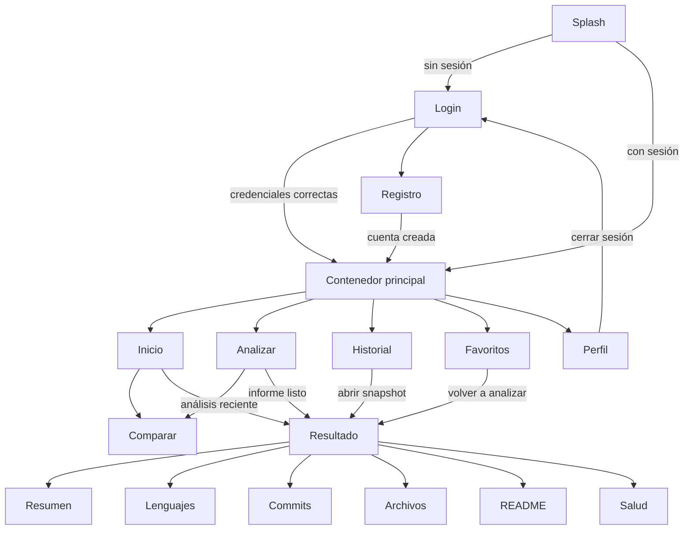
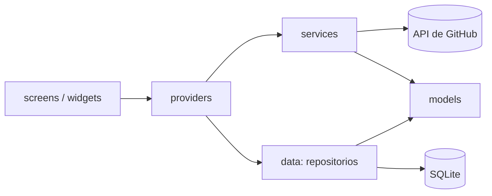
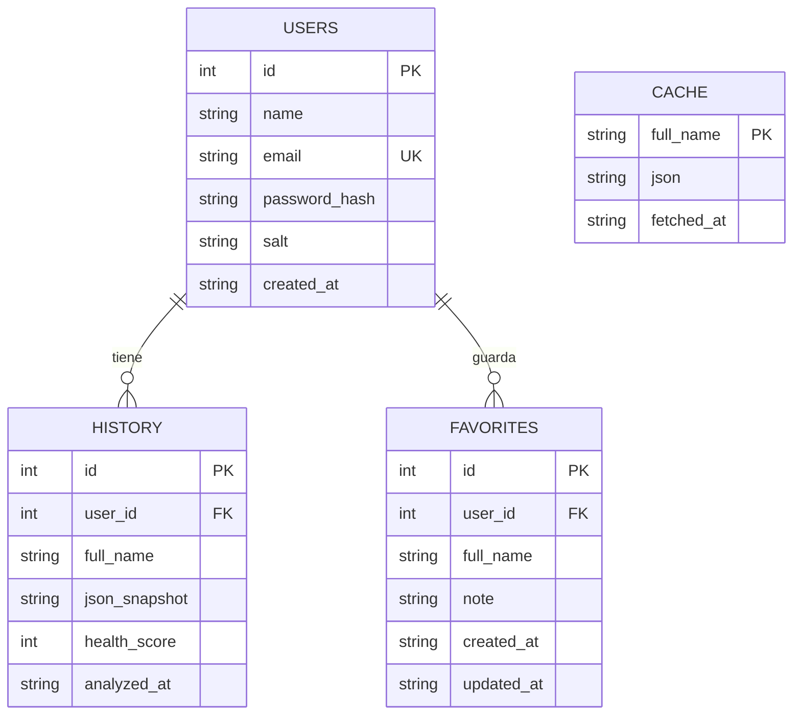

# RepoLens — Documento técnico

## 1. Portada

| | |
|---|---|
| **Proyecto** | RepoLens: informe esencial de repositorios públicos de GitHub |
| **Asignatura** | [ASIGNATURA] |
| **Equipo** | [NOMBRE_EQUIPO] |
| **Integrantes** | Saúl Luna Hernández, grupo 5 B · [INTEGRANTES] |
| **Fecha** | [FECHA] |
| **Tecnología** | Flutter (Dart) para Android |

## 2. Introducción

RepoLens es una aplicación móvil hecha con Flutter. El usuario pega la URL de un repositorio público de GitHub y recibe un informe con lo esencial: datos generales, lenguajes, commits recientes, contribuidores, archivos de la raíz, README, una puntuación de salud y alertas de seguridad. La app no usa ningún servidor propio: consume la API REST pública de GitHub y guarda usuarios, historial, favoritos y caché en una base de datos SQLite dentro del dispositivo.

## 3. Planteamiento del problema

Para decidir si conviene usar, estudiar o contribuir a un repositorio hay que revisar varias pantallas de GitHub: la portada, los commits, los contribuidores, la licencia y los archivos. En el teléfono ese recorrido es lento, y nada indica de un vistazo si el proyecto está cuidado o si alguien subió por error archivos sensibles (por ejemplo, un `.env`). Falta una herramienta móvil que junte esa información en un solo informe y la evalúe.

## 4. Objetivos

**General.** Desarrollar una aplicación móvil multiplataforma en Flutter que analice repositorios públicos de GitHub y presente un informe claro con datos, evaluación de salud y alertas de seguridad, con persistencia local.

**Específicos.**
1. Consumir siete endpoints de la API de GitHub (incluido el árbol completo del repositorio) y convertir sus respuestas JSON en modelos tipados.
2. Implementar autenticación local con contraseña hasheada (SHA-256 + salt) y sesión persistente.
3. Guardar historial, favoritos y caché en SQLite con operaciones CRUD completas.
4. Programar un análisis propio: detección de stack, puntuación de salud y alertas de seguridad.
5. Validar todos los formularios y manejar cada error con un mensaje claro y opción de reintentar.
6. Comprobar el funcionamiento con pruebas unitarias y de widget automatizadas.

## 5. Justificación

El proyecto reúne los temas centrales de la materia en un caso de uso real: interfaz con Material 3, navegación, formularios con validación, consumo de una API REST, parseo de JSON, persistencia local, gestión de estado y pruebas. Al no depender de un servidor propio, la app se puede instalar y evaluar en cualquier teléfono con internet. Además aporta valor más allá de mostrar datos: los interpreta (salud y seguridad), que es lógica de negocio propia y demostrable.

## 6. Tecnologías y herramientas

| Herramienta | Versión | Para qué se usó |
|---|---|---|
| Flutter | 3.47.6 (estable) | Framework de la interfaz |
| Dart | 3.13.5 | Lenguaje |
| Android SDK | 36 | Compilación para Android |
| `provider` | 6.1.5 | Gestión de estado con `ChangeNotifier` |
| `http` | 1.6.0 | Peticiones HTTP |
| `sqflite` / `path` | 2.4.6 / 1.9.1 | Base de datos SQLite |
| `shared_preferences` | 2.5.6 | Sesión y preferencia de tema |
| `flutter_secure_storage` | 11.2.0 | Token de GitHub cifrado |
| `crypto` | 3.0.8 | SHA-256 |
| `fl_chart` | 1.3.1 | Gráfica de pastel |
| `flutter_markdown` | 0.7.7 | Render del README |
| `connectivity_plus` | 7.3.2 | Estado de la red |
| `flutter_launcher_icons` | 0.14.4 | Icono de la app |
| `flutter_test`, `http/testing`, `sqflite_common_ffi` | — | Pruebas automatizadas |
| Git | — | Control de versiones |
| **Claude Code** | — | Herramienta de IA: generó código, pruebas y documentación bajo las instrucciones del autor (ver apartado 16) |

## 7. Requerimientos

**Funcionales**

| Clave | Requerimiento |
|---|---|
| RF1 | Mostrar una pantalla de presentación y un inicio con acceso a las funciones |
| RF2 | Registrar usuarios e iniciar y cerrar sesión de forma local |
| RF3 | Navegar entre Inicio, Analizar, Historial, Favoritos y Perfil |
| RF4 | Validar los formularios de registro, login, URL y nota |
| RF5 | Consultar la API de GitHub y mostrar el informe en seis pestañas |
| RF6 | Detectar el stack, calcular la salud y generar alertas de seguridad |
| RF7 | Comparar dos repositorios lado a lado |
| RF8 | Guardar, consultar, eliminar y vaciar el historial |
| RF9 | Agregar, consultar, editar la nota y eliminar favoritos |
| RF10 | Mostrar mensajes claros y un botón Reintentar ante cada error |
| RF11 | Guardar un token opcional de GitHub de forma segura |
| RF12 | Cambiar entre tema claro, oscuro y del sistema |

**Técnicos**

| Clave | Requerimiento |
|---|---|
| RT1 | Flutter con Material 3 y arquitectura modular por carpetas |
| RT2 | Gestión de estado con `provider` |
| RT3 | SQLite con versión de esquema, `onCreate` y `onUpgrade` |
| RT4 | Contraseñas con SHA-256 y salt; ningún secreto en el código |
| RT5 | Timeout de 10 s por petición y caché de 30 minutos |
| RT6 | `GithubService` con `http.Client` inyectable para pruebas |
| RT7 | `flutter analyze` sin errores y `flutter test` al 100 % |
| RT8 | Diseño adaptable a tableta y accesibilidad básica |

## 8. Diseño de la aplicación

Diagrama de navegación:



Criterios de diseño: Material 3 con una paleta generada desde un color semilla (`#3D5AFE`), tarjetas redondeadas, estados de carga, vacío y error en cada lista, y `LayoutBuilder` para pasar de `NavigationBar` a `NavigationRail` cuando el ancho es de 720 px o más.

## 9. Interfaces

Cada pantalla tiene su archivo en `lib/screens/`. Las capturas van en `Entrega/Evidencias/Capturas/`.

**9.1 Splash** (`splash_screen.dart`). Logo, nombre y lema. Mientras se muestra, crea el usuario demo y restaura la sesión.


**9.2 Login** (`login_screen.dart`). Email y contraseña obligatorios, mensaje de credenciales incorrectas y tarjeta con el usuario de prueba.


**9.3 Registro** (`register_screen.dart`). Nombre, email, contraseña y confirmación, con sus validaciones.


**9.4 Inicio** (`home_screen.dart`). Saludo, descripción del proyecto, accesos a Analizar, Comparar, Historial y Favoritos, y los tres análisis más recientes.


**9.5 Analizar** (`analyze_screen.dart`). Formulario de URL, ejemplos rápidos y estados de carga y error con Reintentar.


**9.6 Resultado** (`result_screen.dart`). Seis pestañas y botón de favorito.
- *Resumen:* avatar, descripción, estrellas, forks, watchers, issues, stack, temas, licencia, tamaño, rama, fechas y contribuidores.
- *Lenguajes:* gráfica de pastel con porcentajes.
- *Commits:* los 10 más recientes.
- *Archivos:* raíz del repo, con los archivos sensibles marcados.
- *README:* Markdown renderizado.
- *Salud:* puntuación de 0 a 100 con el desglose y las alertas.


**9.7 Comparar** (`compare_screen.dart`). Dos URLs y una tabla lado a lado que resalta el mejor valor de cada fila.


**9.8 Historial** (`history_screen.dart`). Lista de análisis con su puntuación; permite reabrir, eliminar uno y vaciar todo.


**9.9 Favoritos** (`favorites_screen.dart`). Lista con nota; permite abrir, editar la nota y eliminar.


**9.10 Perfil** (`profile_screen.dart`). Datos del usuario, selector de tema, token de GitHub y cierre de sesión.


## 10. Arquitectura y estructura

La app está organizada en capas; cada una solo conoce a la de abajo:



| Carpeta | Responsabilidad |
|---|---|
| `lib/core/` | Constantes, tema, formato, validadores y excepciones tipadas |
| `lib/models/` | Clases de datos con `fromJson` y `toJson` |
| `lib/services/` | `GithubService` (HTTP), `Analyzer` (lógica propia), `AuthService`, `ConnectivityService`, `TokenService` |
| `lib/data/` | `DatabaseHelper` y un repositorio por tabla |
| `lib/providers/` | Estado de auth, análisis, historial, favoritos y tema |
| `lib/screens/` | Una pantalla por archivo |
| `lib/widgets/` | Componentes reutilizables |
| `test/` | Pruebas unitarias, de widget y datos simulados |

Las dependencias se crean en `lib/app.dart` con `MultiProvider`. `GithubService` recibe el `http.Client` por constructor, lo que permite sustituirlo por un `MockClient` en las pruebas.

## 11. Modelo de datos

Base de datos `repolens.db`, versión de esquema 1 (`lib/data/database_helper.dart`).

**users**

| Campo | Tipo | Restricción |
|---|---|---|
| id | INTEGER | PK, autoincremental |
| name | TEXT | NOT NULL |
| email | TEXT | NOT NULL, UNIQUE |
| password_hash | TEXT | NOT NULL (SHA-256 en hexadecimal) |
| salt | TEXT | NOT NULL |
| created_at | TEXT | NOT NULL (ISO 8601) |

**history**

| Campo | Tipo | Restricción |
|---|---|---|
| id | INTEGER | PK, autoincremental |
| user_id | INTEGER | NOT NULL, FK a users(id), ON DELETE CASCADE |
| full_name | TEXT | NOT NULL (`owner/repo`) |
| json_snapshot | TEXT | NOT NULL (informe completo en JSON) |
| health_score | INTEGER | NOT NULL |
| analyzed_at | TEXT | NOT NULL |

**favorites**

| Campo | Tipo | Restricción |
|---|---|---|
| id | INTEGER | PK, autoincremental |
| user_id | INTEGER | NOT NULL, FK a users(id), ON DELETE CASCADE |
| full_name | TEXT | NOT NULL |
| note | TEXT | NOT NULL, por defecto vacío, máximo 300 caracteres (validado en la app) |
| created_at | TEXT | NOT NULL |
| updated_at | TEXT | NOT NULL |
| | | UNIQUE(user_id, full_name) |

**cache**

| Campo | Tipo | Restricción |
|---|---|---|
| full_name | TEXT | PK (en minúsculas) |
| json | TEXT | NOT NULL |
| fetched_at | TEXT | NOT NULL |



Relaciones: un usuario tiene muchos registros de historial y muchos favoritos. `cache` no pertenece a ningún usuario: es compartida, porque el informe de un repo público es el mismo para todos.

## 12. Consumo de API

Todas las peticiones salen de `lib/services/github_service.dart`, método privado `_get`, con base `https://api.github.com`, encabezados `Accept: application/vnd.github+json` y `User-Agent: RepoLens-App`, timeout de 10 s y, si existe, `Authorization: Bearer <token>`.

**12.1 `GET /repos/{owner}/{repo}`** — método `getRepo`. Parámetros de ruta: `owner`, `repo`.

```json
{
  "full_name": "octocat/demo",
  "name": "demo",
  "owner": {"login": "octocat", "avatar_url": "https://..."},
  "description": "Repositorio de prueba",
  "stargazers_count": 1500,
  "forks_count": 42,
  "subscribers_count": 30,
  "open_issues_count": 7,
  "license": {"name": "MIT License"},
  "size": 2048,
  "default_branch": "main",
  "created_at": "2020-01-15T10:00:00Z",
  "updated_at": "2026-11-01T12:00:00Z",
  "topics": ["flutter", "dart"]
}
```

Procesamiento: `RepoInfo.fromJson` lee cada campo, toma `owner.login`, `owner.avatar_url` y `license.name` de los objetos anidados, y convierte las fechas con `DateTime.tryParse`.

**12.2 `GET /repos/{owner}/{repo}/languages`** — método `getLanguages`.

```json
{"Dart": 7500, "Kotlin": 2000, "Swift": 500}
```

Procesamiento: `LanguageStat.listFromApi` suma los bytes, calcula el porcentaje de cada lenguaje y ordena de mayor a menor. Se dibuja con `PieChart` de `fl_chart`.

**12.3 `GET /repos/{owner}/{repo}/commits?per_page=10`** — método `getCommits`. Parámetro de consulta: `per_page=10`.

```json
[{
  "sha": "abcdef1234567890",
  "commit": {
    "message": "Agrega pantalla de inicio",
    "author": {"name": "Octo Cat", "date": "2026-11-05T08:30:00Z"}
  },
  "author": {"avatar_url": "https://..."}
}]
```

Procesamiento: `CommitInfo.fromJson` por cada elemento. Un 409 indica repositorio vacío.

**12.4 `GET /repos/{owner}/{repo}/contributors?per_page=10`** — método `getContributors`.

```json
[{"login": "octocat", "avatar_url": "https://...", "contributions": 120}]
```

Procesamiento: `Contributor.fromJson`. Un 204 se trata como lista vacía.

**12.5 `GET /repos/{owner}/{repo}/contents`** — método `getContents`.

```json
[
  {"name": "lib", "path": "lib", "type": "dir", "size": 0},
  {"name": "pubspec.yaml", "path": "pubspec.yaml", "type": "file", "size": 900}
]
```

Procesamiento: `RepoFile.fromJson`. Esta lista alimenta la detección de stack y las alertas de seguridad.

**12.6 `GET /repos/{owner}/{repo}/readme`** — método `getReadme`.

```json
{"name": "README.md", "encoding": "base64", "content": "IyBEZW1vCgpIb2xh\nIFJlcG9MZW5z\n"}
```

Procesamiento: se quitan los saltos de línea de `content`, se decodifica con `base64.decode` y `utf8.decode`, y el texto se muestra con `flutter_markdown`. Un 404 significa que no hay README y devuelve `null`.

`fetchAll` pide primero el repo y después los otros cinco endpoints en paralelo con `Future.wait`.

## 13. Almacenamiento

| Operación | Dónde | Cómo |
|---|---|---|
| **Crear la base** | `DatabaseHelper.database` | `openDatabase` con `version: 1`; `_onCreate` ejecuta los cuatro `CREATE TABLE`; `_onUpgrade` queda listo para migraciones |
| **Crear** | `UserRepository.insert`, `HistoryRepository.insert`, `FavoriteRepository.insert`, `CacheRepository.put` | `db.insert(tabla, modelo.toJson())` |
| **Consultar** | `findByEmail`, `findById`, `listByUser`, `CacheRepository.get` | `db.query` con `where` y `whereArgs`; cada fila pasa por `fromJson` |
| **Actualizar** | `FavoriteRepository.updateNote` | `db.update` de `note` y `updated_at` por `id` |
| **Eliminar** | `HistoryRepository.delete` y `clear`, `FavoriteRepository.delete`, `CacheRepository.clear` | `db.delete` con `where` |

Otros almacenes:
- **Sesión y tema:** `shared_preferences` (id del usuario y modo de tema).
- **Token:** `flutter_secure_storage`, cifrado por el sistema.
- **Caché:** `CacheRepository.get` solo devuelve el JSON si tiene menos de 30 minutos.

Todas las consultas usan `whereArgs` (parámetros), nunca concatenación de texto, lo que evita inyección SQL. `dbGuard` convierte cualquier falla de SQLite en `DatabaseAppException`.

## 14. Validaciones y manejo de errores

**Validaciones** (`lib/core/validators.dart`)

| Campo | Regla | Ejemplo rechazado | Mensaje |
|---|---|---|---|
| Nombre | Obligatorio | (vacío) | El nombre es obligatorio |
| Email | Obligatorio y con formato | `correo-malo` | Escribe un email válido |
| Email (registro) | No duplicado | `demo@repolens.app` | Ya existe una cuenta con ese email |
| Contraseña | 8 o más caracteres, con letra y número | `abc`, `12345678`, `abcdefgh` | Debe tener al menos 8 caracteres / Debe incluir al menos una letra / Debe incluir al menos un número |
| Confirmación | Igual a la contraseña | `Demo1235` | Las contraseñas no coinciden |
| Login | Campos obligatorios | (vacíos) | El email es obligatorio / La contraseña es obligatoria |
| Login | Credenciales correctas | contraseña errónea | Email o contraseña incorrectos |
| URL | Repositorio de github.com | `https://gitlab.com/a/b` | URL inválida. Ejemplo: https://github.com/flutter/flutter |
| Nota | Máximo 300 caracteres | 301 caracteres | La nota no puede superar 300 caracteres |

URLs aceptadas, todas normalizadas a `owner/repo`: `https://github.com/owner/repo`, `github.com/owner/repo`, `https://github.com/owner/repo.git` y `https://github.com/owner/repo/tree/main/lib`.

**Errores** (`lib/core/exceptions.dart`)

| Situación | Excepción | Mensaje al usuario |
|---|---|---|
| Sin red (`SocketException` o `connectivity_plus`) | `NoConnectionException` | Sin conexión a internet. Revisa tu red e inténtalo de nuevo. |
| Más de 10 s | `RequestTimeoutException` | El servidor tardó demasiado en responder. |
| 404 | `NotFoundException` | No se encontró el repositorio. Puede que no exista o sea privado. |
| 403 sin peticiones restantes, o 429 | `RateLimitException` | Se alcanzó el límite de peticiones de GitHub. Se reinicia a las HH:MM. |
| 409 en commits | `EmptyRepoException` | El repositorio está vacío. |
| JSON inválido o con otra forma | `UnexpectedJsonException` | GitHub devolvió una respuesta inesperada. |
| Falla de SQLite | `DatabaseAppException` | Ocurrió un error con la base de datos local. |

La hora de reinicio sale del encabezado `X-RateLimit-Reset`. `ErrorView` (`lib/widgets/state_views.dart`) muestra el icono, el mensaje y el botón **Reintentar**. Las operaciones de guardar, actualizar y eliminar se confirman con un `SnackBar`, y antes de eliminar aparece un diálogo de confirmación.

## 15. Pruebas realizadas

Resultado del 2026-11-11:

- `flutter analyze`: **No issues found.**
- `flutter test`: **77 pruebas, todas aprobadas.**

| Archivo | Pruebas | Qué cubre |
|---|---|---|
| `test/unit/validators_test.dart` | 12 | URLs válidas e inválidas, email, contraseña débil, confirmación, nota |
| `test/unit/models_test.dart` | 7 | Parseo y serialización de cada modelo |
| `test/unit/analyzer_test.dart` | 8 | Detección de stack, alertas de seguridad y salud |
| `test/unit/github_service_test.dart` | 10 | Respuestas 200, 404, 403, 429, 409, sin conexión, timeout, JSON inesperado y token, con `MockClient` |
| `test/unit/auth_test.dart` | 6 | Hash SHA-256 con salt, registro, login, duplicados y sesión |
| `test/unit/database_test.dart` | 6 | SQLite real: usuarios, CRUD de favoritos, historial, caché y errores |
| `test/widget/auth_screens_test.dart` | 6 | Login y registro |
| `test/widget/url_form_test.dart` | 4 | Formulario de URL y vista de error |
| `test/widget/navigation_test.dart` | 2 | Navegación entre secciones y vista de tableta |

**Alcance:** la API se simuló con `MockClient` y la base de datos se probó con el motor SQLite de escritorio. La app **no se ha probado todavía en un teléfono o emulador**; esa verificación manual y sus capturas están pendientes.

**Matriz de pruebas (resumen).** La matriz completa, con 24 casos, está en `Entrega/Evidencias/Pruebas/MatrizPruebas.md`.

| No. | Funcionalidad | Acción realizada | Resultado esperado | Resultado obtenido | Aprobada | Evidencia |
|---|---|---|---|---|---|---|
| 1 | Login correcto | Entrar con el usuario demo | Entra a la app | Navega a la pantalla principal | Sí | `auth_screens_test.dart` |
| 2 | Contraseña incorrecta | Contraseña `Incorrecta1` | Mensaje de error | "Email o contraseña incorrectos" | Sí | `auth_screens_test.dart` |
| 3 | Campos vacíos | Entrar sin datos | Mensajes de obligatorio | Dos mensajes mostrados | Sí | `auth_screens_test.dart` |
| 4 | Consulta a la API | Analizar `octocat/demo` | Informe completo | 7 endpoints parseados | Sí (simulada) | `github_service_test.dart` |
| 5 | Sin conexión | Analizar sin red | Mensaje y Reintentar | `NoConnectionException` | Sí | `database_test.dart` |
| 6 | Repo inexistente | Analizar `no/existe` | Mensaje de no encontrado | `NotFoundException` | Sí | `github_service_test.dart` |
| 7 | Guardar favorito | Agregar con nota | Queda en SQLite | Se lee al recargar | Sí | `database_test.dart` |
| 8 | Consultar historial | Dos análisis | Dos entradas | Dos entradas con puntuación | Sí | `database_test.dart` |
| 9 | Navegación | Tocar cada sección | Cambia de sección | Cinco secciones mostradas | Sí | `navigation_test.dart` |
| 10 | URL inválida | `https://gitlab.com/a/b` | Mensaje, no envía | "URL inválida..." | Sí | `url_form_test.dart` |
| 11 | Editar nota | Cambiar la nota | Nota actualizada | "Nota editada" al recargar | Sí | `database_test.dart` |
| 12 | Eliminar registro | Eliminar favorito e historial | Desaparecen | Listas vacías | Sí | `database_test.dart` |

## 16. Uso de IA

Se usó **Claude Code** (Anthropic) como asistente de programación. El autor escribió el documento de requisitos y la IA trabajó a partir de él.

| Qué hizo la IA | Qué hizo el autor |
|---|---|
| Generó el código de la app, las pruebas y los borradores de la documentación | Definió requisitos, alcance, arquitectura obligatoria y criterios de aceptación |
| Diagnosticó y resolvió errores de compilación y de entorno | Revisa y entiende el código para poder explicarlo en la defensa |
| Ejecutó `flutter analyze` y `flutter test` y corrigió lo que fallaba | Prueba la app en el teléfono, toma las capturas y graba el video |

Límites reconocidos: el código generado no se da por bueno sin verificación. Por eso hay 77 pruebas automatizadas y una matriz que distingue lo comprobado de forma automática de lo que falta comprobar a mano. Los ejemplos de prompts y lo que se aprendió de cada uno están en la bitácora.

## 17. Problemas encontrados y soluciones

| Problema | Causa | Solución |
|---|---|---|
| Gradle: `Unable to establish loopback connection` | El JDK de Android Studio (JBR 25) no pudo crear sockets de dominio Unix en la carpeta temporal por defecto | Definir `JAVA_TOOL_OPTIONS=-Djdk.net.unixdomain.tmpdir=<carpeta corta>` antes de compilar |
| `dart run flutter_launcher_icons`: `Failed to canonicalize path ... OS error (122)` | La ruta del proyecto superaba el límite de Windows | Se movió el proyecto a `Documentos\RepoLens`; ahí el comando funcionó |
| Kotlin: `Could not close incremental caches` | Se compilaba desde una unidad virtual (`subst R:`) distinta a la de la caché de paquetes | Compilar desde la ruta real y corta, sin unidad virtual |
| Desborde de 10 px en las tarjetas de Inicio en pantallas anchas | Cuadrícula con proporción fija (`childAspectRatio`) | Alto fijo por tarjeta con `mainAxisExtent`; lo detectó la prueba de navegación |
| Aviso `unawaited_return_in_try_block` | Se devolvía un `Future` dentro de un `try` | Separar la petición (dentro del `try`) del parseo (fuera) |
| Mensaje "La contraseña es obligatorio" | El validador armaba el texto con una plantilla en masculino | `Validators.required` recibe el mensaje completo |
| 403 en contribuidores de repos enormes | GitHub responde 403 sin ser límite de peticiones | Solo es límite si `X-RateLimit-Remaining` es 0; en otro caso la lista sale vacía |

## 18. Conclusiones

RepoLens cumple el objetivo: reúne en un informe móvil la información clave de un repositorio y la evalúa. El proyecto dejó tres aprendizajes. Primero, separar capas (pantallas, providers, servicios, datos) hace que cada parte se pueda probar sola; inyectar el `http.Client` permitió simular todos los errores de red sin internet. Segundo, tipar las excepciones convierte los errores en mensajes útiles en vez de pantallas rotas. Tercero, las pruebas encuentran fallos que la revisión visual no ve, como el desborde en pantallas anchas.

Trabajo futuro: probar en más dispositivos, navegar por subcarpetas del repositorio, agregar gráficas de actividad de commits y publicar versiones para iOS y web.

## 19. Referencias

Dart. (s. f.). *Dart documentation*. https://dart.dev/guides

Flutter. (s. f.). *Flutter documentation*. https://docs.flutter.dev

GitHub. (s. f.). *GitHub REST API documentation*. https://docs.github.com/en/rest

GitHub. (s. f.). *Rate limits for the REST API*. https://docs.github.com/en/rest/using-the-rest-api/rate-limits-for-the-rest-api

Paquetes de pub.dev (documentación de cada uno):

- connectivity_plus. https://pub.dev/packages/connectivity_plus
- crypto. https://pub.dev/packages/crypto
- fl_chart. https://pub.dev/packages/fl_chart
- flutter_launcher_icons. https://pub.dev/packages/flutter_launcher_icons
- flutter_markdown. https://pub.dev/packages/flutter_markdown
- flutter_secure_storage. https://pub.dev/packages/flutter_secure_storage
- http. https://pub.dev/packages/http
- path. https://pub.dev/packages/path
- provider. https://pub.dev/packages/provider
- shared_preferences. https://pub.dev/packages/shared_preferences
- sqflite. https://pub.dev/packages/sqflite
- sqflite_common_ffi. https://pub.dev/packages/sqflite_common_ffi

Anthropic. (s. f.). *Claude Code documentation*. https://docs.claude.com/en/docs/claude-code/overview
