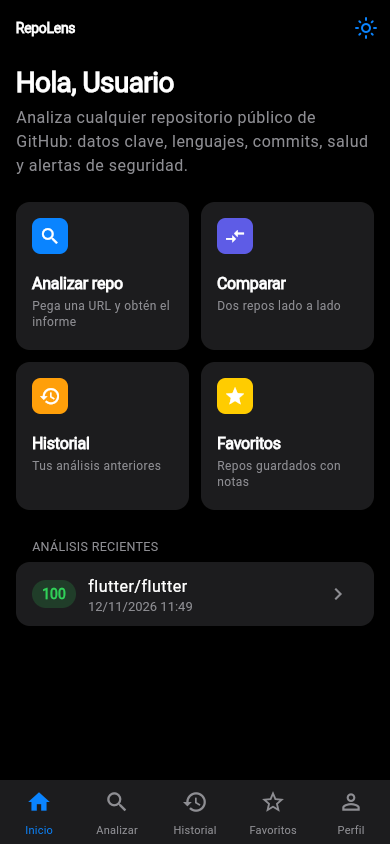
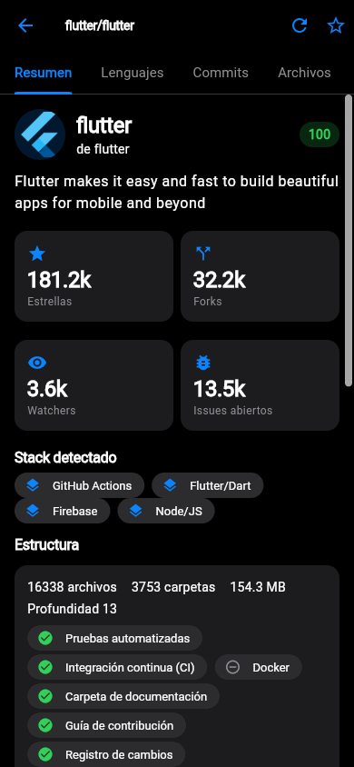
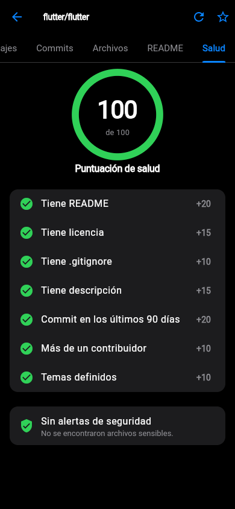

<div align="center">


# RepoLens

**El informe esencial de cualquier repositorio público de GitHub, en tu bolsillo.**

Pega una URL y obtén datos clave, lenguajes, commits, estructura, salud del proyecto,<br>
alertas de seguridad y consejos concretos para mejorarlo. Sin servidor propio.


**[Abrir la app web](https://sluna5-coder.github.io/RepoLens/)** · **[Descargar la APK](https://sluna5-coder.github.io/RepoLens/RepoLens.apk)**

[Funciones](#funciones) · [Ejecutar](#ejecutar) · [Arquitectura](#arquitectura) · [Documentación](#documentación)

<br>

<table>
  <tr>
    <td align="center">
      <picture>
        <source media="(prefers-color-scheme: light)" srcset="docs/screenshots/inicio-claro.png">
        
      </picture>
      <br><sub><b>Inicio</b></sub>
    </td>
    <td align="center">
      <picture>
        <source media="(prefers-color-scheme: light)" srcset="docs/screenshots/resumen-claro.png">
        
      </picture>
      <br><sub><b>Informe</b></sub>
    </td>
    <td align="center">
      <picture>
        <source media="(prefers-color-scheme: light)" srcset="docs/screenshots/salud-claro.png">
        
      </picture>
      <br><sub><b>Salud</b></sub>
    </td>
  </tr>
</table>

<sub>Las capturas siguen el tema de GitHub: oscuro o claro.</sub>

</div>

---

| | |
|---|---|
| **Equipo** | [NOMBRE_EQUIPO] |
| **Integrantes** | Saúl Luna Hernández, Emmanuel Alejandro, Gustavo Ceja Quintero, Pedro Andrés Aguilar y Jorge Luis Pizano Saucedo (grupo 5 B) |
| **Asignatura** | [ASIGNATURA] |
| **Fecha** | [FECHA] |

## Pruébala

| Web (cualquier dispositivo) | APK (Android) |
|:---:|:---:|
|  |  |
| [sluna5-coder.github.io/RepoLens](https://sluna5-coder.github.io/RepoLens/) | [RepoLens.apk](https://sluna5-coder.github.io/RepoLens/RepoLens.apk) |

Usuario de prueba: `demo@repolens.app` / `Demo1234`. Para instalar la APK, Android pide permitir apps de origen desconocido.

## Funciones

|   |   |
|---|---|
| 🔍 **Análisis completo** | Seis pestañas: Resumen, Lenguajes (gráfica), Commits, Archivos, README y Salud. |
| 🧱 **Estructura real** | Lee todo el árbol del repositorio: stack en subcarpetas, tipos de archivo, archivos más pesados y buenas prácticas (pruebas, CI, Docker, documentación). |
| 💚 **Salud de 0 a 100** | Siete criterios con desglose y una lista de "Qué mejorar" con consejos concretos. |
| 🛡️ **Alertas de seguridad** | Detecta archivos sensibles (`.env`, llaves, keystores) en cualquier carpeta. |
| ⚖️ **Comparar** | Dos repositorios lado a lado; resalta el mejor valor de cada fila. |
| 🕘 **Historial y favoritos** | Reabre informes sin conexión y guarda repositorios con notas. |
| 🌗 **Tema oscuro y claro** | Oscuro por defecto; botón de sol y luna en Inicio y opciones en Perfil. |
| 🔐 **Cuenta local** | Registro e inicio de sesión con SQLite y contraseña con SHA-256 y salt. |
| ⚡ **Caché y errores claros** | Caché de 30 minutos, botón Actualizar y mensajes para cada falla: sin red, 404, límite de peticiones, repo vacío. |

## Ejecutar

```bash
git clone <URL_DEL_REPOSITORIO>
cd RepoLens
flutter pub get
```

| Dónde | Cómo |
|---|---|
| **Android** (teléfono o emulador) | `flutter run` |
| **Chrome** | `flutter run -d chrome` |
| **Visual Studio Code** | *Ejecutar y depurar* (Ctrl+Shift+D) → **RepoLens (Chrome)** o **RepoLens (Android)** → F5 |

**Usuario de prueba** (se crea solo en la primera ejecución): `demo@repolens.app` / `Demo1234`.

<details>
<summary><b>Generar la APK</b></summary>

```bash
flutter build apk --release
```

La APK queda en `build/app/outputs/flutter-apk/app-release.apk`. La copia de entrega está en `Entrega/Aplicacion/RepoLens.apk`.

Si Gradle falla con `Unable to establish loopback connection`, define antes esta variable (ver `DECISIONES.md`):

```bash
set JAVA_TOOL_OPTIONS=-Djdk.net.unixdomain.tmpdir=C:\ruta\corta\temporal
```

Para regenerar el icono: `dart run flutter_launcher_icons`.
</details>

<details>
<summary><b>Pruebas y análisis estático</b></summary>

```bash
flutter analyze
flutter test
flutter test integration_test/app_test.dart -d <dispositivo>
```

La prueba de integración recorre la app completa en un emulador o teléfono (registro, login, análisis, favoritos, historial, errores, comparación, tema y cierre de sesión) con la API de GitHub simulada.

97 pruebas: unitarias (validadores, modelos, analizador, servicio de GitHub, autenticación, SQLite real) y de widgets (login, registro, formulario de URL y navegación).
</details>

<details>
<summary><b>Token opcional de GitHub</b></summary>

Sin token, la API permite 60 peticiones por hora; con token, 5000.

1. En GitHub: *Settings → Developer settings → Personal access tokens → Fine-grained tokens → Generate new token*. No hace falta ningún permiso extra.
2. En la app: **Perfil → Token de GitHub → Pegar token personal → Guardar token**.

El token se guarda cifrado solo en el dispositivo con `flutter_secure_storage`. Nunca se escribe en el código ni en el repositorio.
</details>

<details>
<summary><b>Requisitos</b></summary>

- Flutter 3.47.6 o superior (canal estable), Dart 3.13.5.
- Android SDK 36 con build-tools 36.0.0.
- JDK 17 o superior (sirve el que incluye Android Studio).
- Para web: Google Chrome. SQLite corre como WebAssembly (`web/sqlite3.wasm`) y los datos se guardan en el navegador.
</details>

## Arquitectura

```
Pantallas y widgets  →  Providers (ChangeNotifier)  →  Servicios y repositorios  →  Modelos
                                                         │                 │
                                                  API de GitHub        SQLite local
```

```
lib/
  main.dart                # punto de entrada (SQLite web si corre en el navegador)
  app.dart                 # MaterialApp, providers, temas y rutas
  core/                    # constants, theme, utils, validators, exceptions
  models/                  # repo_info, language_stat, commit_info, contributor, repo_file,
                           # repo_insights, analysis_result, user, favorite, history_entry
  services/                # github_service, analyzer, auth_service,
                           # connectivity_service, token_service
  data/                    # database_helper y un repositorio por tabla
  providers/               # auth, analysis, history, favorites, theme
  screens/                 # splash, login, register, main_shell, home, analyze,
                           # result, compare, history, favorites, profile
  widgets/                 # state_views, url_form, common
test/                      # unit/, widget/ y mocks/
web/                       # versión para navegador
Entrega/                   # APK, documentación, evidencias y bitácora
```

<details>
<summary><b>Endpoints de la API de GitHub</b></summary>

Todos son `GET` sobre `https://api.github.com`:

| Endpoint | Datos |
|---|---|
| `/repos/{owner}/{repo}` | Descripción, estrellas, forks, watchers, issues, licencia, tamaño, rama, fechas, temas, avatar |
| `/repos/{owner}/{repo}/languages` | Bytes por lenguaje (se convierten a porcentajes) |
| `/repos/{owner}/{repo}/commits?per_page=10` | Commits recientes |
| `/repos/{owner}/{repo}/contributors?per_page=10` | Contribuidores |
| `/repos/{owner}/{repo}/contents` | Archivos de la raíz |
| `/repos/{owner}/{repo}/readme` | README en base64 |
| `/repos/{owner}/{repo}/git/trees/{rama}?recursive=1` | Árbol completo del repositorio |
</details>

<details>
<summary><b>Tecnologías</b></summary>

| Tecnología | Uso |
|---|---|
| Flutter 3.47.6 / Dart 3.13.5 | Framework y lenguaje |
| `provider` | Gestión de estado |
| `http` | Peticiones a la API de GitHub |
| `sqflite`, `sqflite_common_ffi_web`, `path` | SQLite en Android y en el navegador |
| `shared_preferences` | Sesión y tema |
| `flutter_secure_storage` | Token de GitHub |
| `crypto` | Hash SHA-256 de contraseñas |
| `fl_chart` | Gráfica de lenguajes |
| `flutter_markdown`, `flutter_svg` | Render del README, con imágenes SVG |
| `connectivity_plus` | Verificación de red |
| `flutter_launcher_icons` | Iconos de la app |
| `flutter_test`, `http/testing`, `sqflite_common_ffi` | Pruebas |
</details>

## Documentación

| Documento | Contenido |
|---|---|
| [`DocumentoTecnico.md`](Entrega/Documentacion/DocumentoTecnico.md) | Documento técnico completo |
| [`MatrizPruebas.md`](Entrega/Evidencias/Pruebas/MatrizPruebas.md) | Matriz de pruebas |
| [`BitacoraDesarrollo.md`](Entrega/Bitacora/BitacoraDesarrollo.md) | Bitácora de desarrollo |
| [`GUIA_DEFENSA.md`](GUIA_DEFENSA.md) | Guía de estudio para la exposición |
| [`GUION_VIDEO.md`](GUION_VIDEO.md) | Guion del video de demostración |
| [`DECISIONES.md`](DECISIONES.md) | Decisiones tomadas y problemas de entorno |
| [`RepoLens.pptx`](Entrega/Presentacion/RepoLens.pptx) | Presentación para la exposición |

<div align="center"><sub>Hecho con Flutter · Datos de la API pública de GitHub</sub></div>
